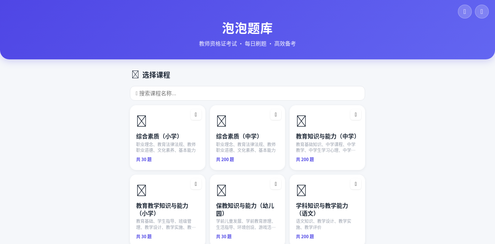
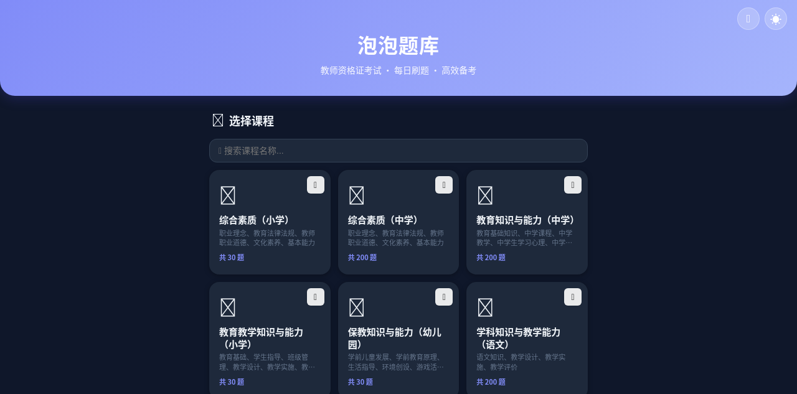
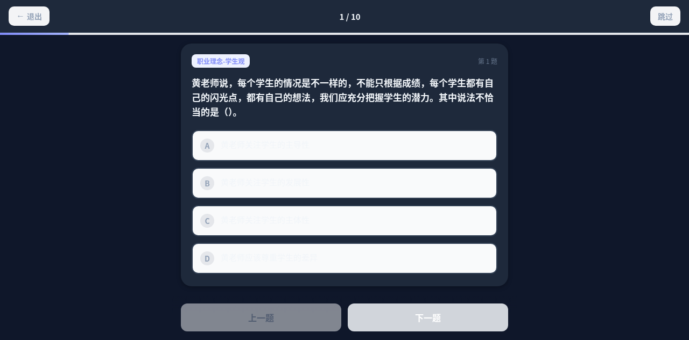
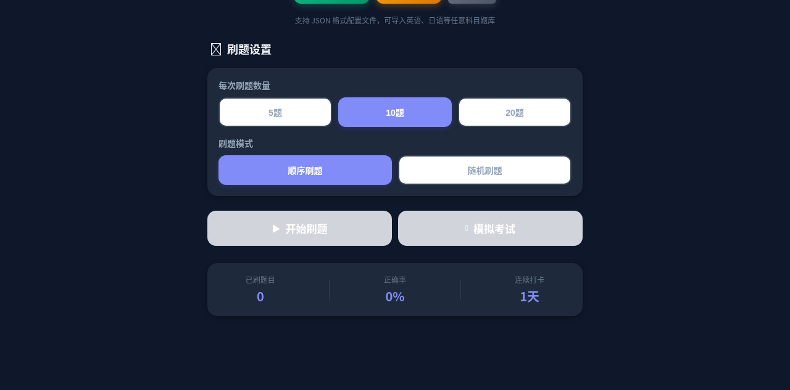
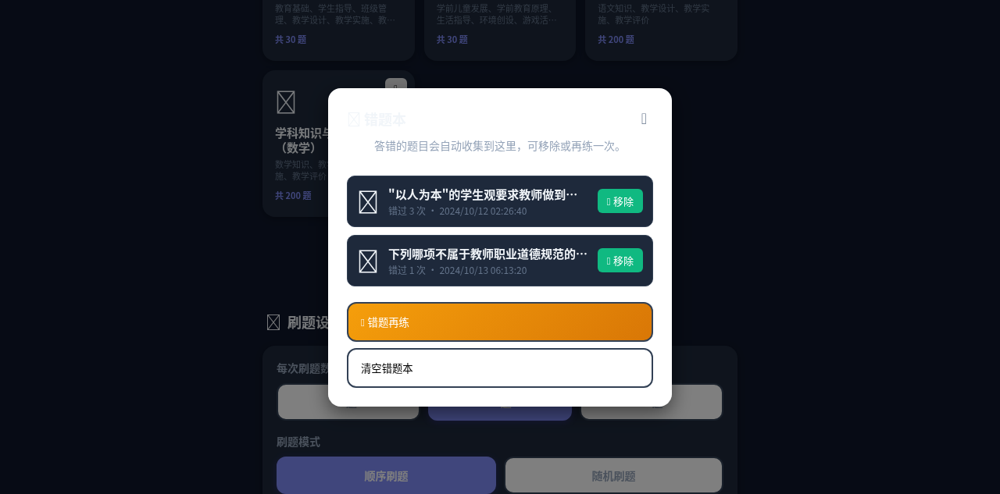

# 🫧 泡泡题库 (Paopao Quiz)

> 一款面向教师资格证考试的移动端刷题应用，支持自定义题库导入、错题本、模拟考试、主题切换与个性化背景。纯前端实现，基于 Capacitor 打包为 Android APK。


---

## 📦 Releases

### v1.3.3（2026-10-19）

- 🐛 修复更新下载完成后「卡住」的问题：需要「安装未知应用」权限时，授权返回后**自动继续安装**（此前授权回来流程就断了）
- ✨ 下载进度显示下载字节数（如 `42% · 1.3MB/3.2MB`）
- ✨ 启动时检查遗留更新包：**已装完的提示删除**释放空间；**下载了没装的提示继续安装**；损坏的包也可清理

### v1.3.2（2026-10-19）

- 🐛 修复：成就 / 学习日历 / 收藏夹弹窗透明看不清的问题（`.modal` 容器类此前未定义样式）
- ✨ 「传送门」更名为**导入在线题库**、「导入题库」更名为**导入本地题库**
- ✨ 首页 7 个功能按钮改为两列网格整齐排列，按「导入 → 复习 → 成长 → 回收站」分组排序

### v1.3.1（2026-10-19）

- 🐛 修复：首页右上角 🖼️「自定义背景」按钮没有绑定点击事件、点了只有波纹动画的问题 —— 现在与 🌙 一样打开主题/背景面板

### v1.3.0（2026-10-19）

> 📥 **下载 APK**：[paopao-quiz-v1.3.0.apk](https://github.com/cedarln/paopao-quiz/releases/download/v1.3.0/paopao-quiz-v1.3.0.apk)

- 文件大小：3.2 MB
- MD5：`726fbd539cad1351faa021ea2815bee8`

- ✅ 新增 **传送门 · 在线题库广场**：首页新入口，列出 GitHub `quizzes/` 目录下的题库 JSON，点击即可在线加载 / 更新，带「未加载 / 有更新 / 已加载」状态标记 —— 发布新题库后用户无需再手动下载导入
- ✅ 新增 **检查更新**：首页 🔄 按钮，查询 GitHub Release 比较版本；App 内通过系统 DownloadManager 下载（通知栏进度）并自动拉起安装器，与泡泡课表同一套方案
- ✅ 从本版本起 APK 采用专用 release 签名（`keystore/paopao-quiz.jks`，密钥不入库）

### v1.2.0（2026-10-13）

> 📥 **下载 APK**：[paopao-quiz-v1.2.0.apk](https://github.com/cedarln/paopao-quiz/releases/download/v1.2.0/paopao-quiz-v1.2.0.apk)
>
> 也可在 [Releases 页面](https://github.com/cedarln/paopao-quiz/releases/tag/v1.2.0) 查看。

- 文件大小：4.1 MB
- MD5：`b3de340e78eb4bd7a87d0d75fb3a1669`

**本次更新**
- ✅ 新增 **错题本**：答错题目自动收集，支持错题再练、单题移除、一键清空
- ✅ 新增 **模拟考试**：可配置题量与时长，限时答题，交卷统一判分
- ✅ 新增 **题库导入**：支持 JSON 配置文件导入英语/日语等自定义题库，同主题可覆盖/追加
- ✅ 新增 **回收站**：所有卡片支持删除，误删可恢复或彻底删除

### v1.0.0（初始版本）

- 7 个内置教资科目题库
- 顺序/随机刷题模式，即时答案反馈与解析
- 4 套主题切换 + 自定义图片/视频背景
- 分类筛选与课程搜索
- 学习统计（累计答题数、正确率、连续打卡）

---

## ✨ 功能特性

### 📚 核心刷题
- **7 个内置教资科目**：综合素质（小学/中学）、教育知识与能力（中学）、教育教学知识与能力（小学）、保教知识与能力（幼儿园）、学科知识与教学能力（语文/数学）
- **顺序 / 随机两种模式**，可选题量（5 / 10 / 15 / 20 / 全部）
- **即时答案反馈**：选中后立即显示对错与解析
- **答题回顾**：结束后可查看全部题目、对错情况与解析

### 📥 题库导入
- 支持导入 **JSON 格式** 自定义题库（英语、日语、公考等任意科目）
- 同主题题库导入冲突时可选 **覆盖** 或 **追加**
- 导入的题库持久化存储，可单独删除

### 🌀 传送门（在线题库广场）
- 题库 JSON 统一放在本仓库的 **`quizzes/` 目录**，App 内通过 GitHub Contents API 在线列出
- 点击即可在线加载 / 更新题库（走同一套校验与冲突处理），无需手动下载导入
- 每个文件显示「未加载 / 有更新 / 已加载」状态（按文件内容 sha 判断，发布即更新）
- **发布新题库**：把符合 [配置格式](#-题库配置文件格式) 的 JSON 上传到 `quizzes/` 目录即可（GitHub 网页端 Add file → Upload files 就行）。文件名可用 `展示名~文件名.json` 让 App 里显示更友好的名字，例如 `英语高频词~english-500.json`
- 用户在 App 传送门里点「刷新列表」即可拿到最新题库

### 🔄 检查更新
- 首页右上角 🔄 按钮，查询本仓库 GitHub Releases 的最新版本
- App 内：发现新版本弹窗展示更新说明，确认后系统 DownloadManager 下载（通知栏进度），完成后自动拉起安装器（Android 8+ 需允许「安装未知应用」）
- 浏览器访问时退化为跳转下载链接
- **发版流程**：改 `android/app/build.gradle` 的 `versionCode/versionName` 与 `js/app.js` 里的 `APP_VERSION` → 构建**签名** release APK → 创建 tag `vX.Y.Z` 的 Release 并上传 APK

### 🗑️ 回收站
- 删除的课程卡片进入回收站，可恢复或彻底删除
- 已彻底删除的题库不会因刷新而复活

### ❌ 错题本
- 练习与考试中答错的题目自动收集
- 记录错过次数与最近答错时间
- 支持 **错题再练**，单独强化薄弱知识点
- 可单题移除或一键清空

### 📝 模拟考试
- 可配置题目数量与考试时长（5/10/15/20/30/60 分钟）
- 考试中**不显示即时反馈**，可自由翻页修改答案
- 顶部实时倒计时，剩余 ≤1 分钟变红闪烁
- 时间到自动交卷，交卷后统一判分并展示结果
- 答错的题目自动加入错题本

### 🏷️ 分类筛选 & 🔍 搜索
- 选中科目后自动显示该科目所有题目分类标签
- 按分类刷题，针对性突破薄弱章节
- 首页搜索框按课程名称/描述实时过滤

### 🎨 个性化
- **4 套主题**：浅色 / 深色 / 极光绿 / 日落橙，选择持久化
- **自定义背景**：支持选择本地图片或视频作为应用背景，带半透明遮罩保证可读性
- **炫酷动画**：卡片悬浮光扫、按钮水波纹、选项弹跳/抖动、页面淡入

### 📊 学习统计
- 累计刷题数、正确率
- 连续打卡天数

---

## 🛠️ 技术栈

| 层级 | 技术 |
|------|------|
| 前端 | 原生 HTML5 + CSS3 + JavaScript (ES6+) |
| 移动端打包 | [Capacitor 8](https://capacitorjs.com/) |
| 构建 | Gradle 8 + JDK 21 + Android SDK |
| 存储 | `localStorage`（题库、设置、错题、统计） |

---

## 📁 项目结构

```
teacher-quiz-app/
├── index.html              # 应用入口（所有页面结构）
├── css/
│   └── style.css           # 全局样式 + 主题变量 + 动画
├── js/
│   ├── app.js              # 应用逻辑（状态、渲染、事件）
│   └── data/               # 内置题库数据
│       ├── zhsz-xiaoxue.js
│       ├── zhsz-zhongxue.js
│       ├── jyzn-zhongxue.js
│       ├── jyjx-xiaoxue.js
│       ├── bjz-youeryuan.js
│       ├── xk-yuwen.js
│       └── xk-shuxue.js
├── samples/                # 示例题库配置文件
│   ├── CONFIG_FORMAT.md    # 题库格式规范
│   ├── english-vocab-basic.json
│   └── japanese-vocab-basic.json
├── android/                # Capacitor Android 工程
├── capacitor.config.json
├── package.json
└── .gitignore
```

---

## 🚀 快速开始

### 方式一：Web 本地预览

```bash
cd teacher-quiz-app
python3 -m http.server 8090
# 浏览器打开 http://localhost:8090
```

### 方式二：构建 Android APK

确保已安装 **JDK 21** 与 **Android SDK**，然后运行：

```bash
./build-apk.sh
```

构建成功后 APK 位于 `/workspace/泡泡题库.apk`。

---

## 📝 题库配置文件格式

题库文件为 JSON 格式，UTF-8 编码。完整规范见 [`samples/CONFIG_FORMAT.md`](samples/CONFIG_FORMAT.md)。

### 基本结构

```json
{
  "version": "1.0",
  "key": "english-vocab-basic",
  "name": "英语基础词汇",
  "icon": "🇬🇧",
  "description": "英语常用词汇练习",
  "questions": [
    {
      "id": 1,
      "category": "词汇-动词",
      "question": "选择单词 abandon 的正确中文释义：",
      "options": ["放弃，抛弃", "接受，承认", "适应，调整", "钦佩，赞美"],
      "answer": 0,
      "explanation": "abandon vt. 放弃，抛弃。"
    }
  ]
}
```

### 字段说明

| 字段 | 类型 | 必填 | 说明 |
|------|------|------|------|
| `key` | string | ✅ | 题库唯一标识（英文小写+连字符） |
| `name` | string | ✅ | 题库名称 |
| `questions` | array | ✅ | 题目数组 |
| `icon` | string | ❌ | emoji 图标，默认 📝 |
| `description` | string | ❌ | 题库描述 |
| `category` | string | ❌ | 分类标签 |

### 题目字段

| 字段 | 类型 | 必填 | 说明 |
|------|------|------|------|
| `question` | string | ✅ | 题干 |
| `options` | array | ✅ | 选项数组（≥2） |
| `answer` | number | ✅ | 正确答案索引（从 0 开始） |
| `explanation` | string | ❌ | 答案解析 |
| `category` | string | ❌ | 题目分类（用于分类筛选） |

> 💡 你可以把 doc / pdf / url 链接发给我，我会帮你制作成对应的题库配置文件。

---

## 🎨 自定义主题与背景

### 主题切换
点击右上角 🌙 按钮，在弹出面板中选择主题：浅色 / 深色 / 极光绿 / 日落橙。主题选择会持久化保存。

### 自定义背景
1. 点击右上角 🖼️ 按钮，选择本地图片或视频
2. 背景以 base64 存入 localStorage，刷新后保持
3. 在主题面板中点击「🔄 恢复默认背景」可还原

---

## 💾 本地存储说明

应用使用 `localStorage` 持久化以下数据：

| Key | 说明 |
|-----|------|
| `quiz-imported-banks` | 用户导入的题库数据 |
| `quiz-recycle-bin` | 回收站中的题库 |
| `quiz-hidden-keys` | 已彻底删除的内置题库 key |
| `quiz-wrong-book` | 错题本 |
| `quiz-stats` | 学习统计（答题数、正确率、打卡） |
| `quiz-theme` | 当前主题 |
| `quiz-bg` | 自定义背景（图片/视频 base64） |

---

## 📸 应用截图

<div align="center">

| 首页（浅色主题） | 首页（深色主题） |
| :---: | :---: |
|  |  |

| 答题页面 | 模拟考试配置 |
| :---: | :---: |
|  |  |

| 错题本 |
| :---: |
|  |

</div>

---

## 🗺️ 路线图

- [ ] 学习日历热力图
- [ ] 成就系统 / 勋章
- [ ] APP 内题目编辑器
- [ ] 题库导出 / 分享
- [ ] 每日刷题提醒通知
- [ ] AI 辅助生成题库

---

## 📄 许可证

MIT License

---

## 🤝 贡献

欢迎提交 Issue 和 Pull Request！
